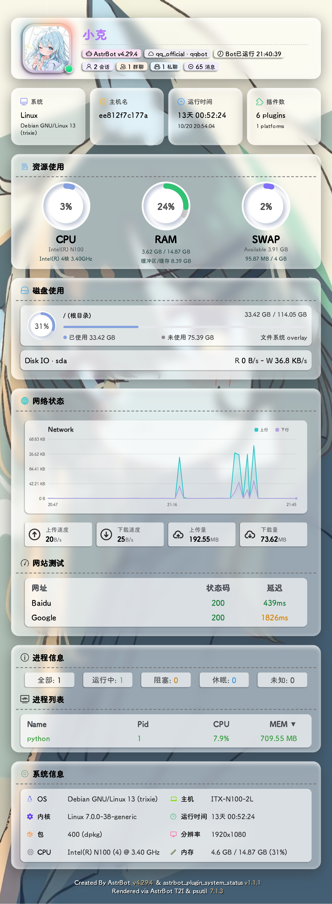

# astrbot_plugin_system_status

一个用于 AstrBot 的系统状态展示插件，移植自[Yenai-Plugin](https://github.com/yeyang52/yenai-plugin)，可生成系统状态卡片和资源监控图表，直观展示 Bot 运行状态、硬件资源、网络与磁盘使用情况。

## 预览



## 功能

- `/状态`：系统状态卡片
  - Bot 信息区：多平台列表、头像、平台、运行时间、消息数、会话数、群聊/私聊数
  - 系统信息：系统版本、主机名、运行时间、插件数
  - 资源使用：CPU、RAM、SWAP、GPU 圆环
  - 磁盘使用：容量环、进度条、磁盘 IO
  - 网络状态：上传/下载速度、累计流量、网络测试、网络折线图
  - 进程负载：进程状态统计、Top 进程列表
  - 系统信息：优先使用 `fastfetch`，未安装时自动用 Python 生成
- `/状态监控`：CPU、RAM、Network、Disk IO 四张 SVG 折线图

## 安装

> 需要 AstrBot >= 4.x，并确保 T2I 渲染服务可用。
>

### 方式一：通过 AstrBot 插件市场安装（推荐）

在 AstrBot 管理面板中搜索 `astrbot_plugin_system_status` 并安装。

### 方式二：手动安装

1. 克隆本仓库到 AstrBot 的插件目录：

   ```bash
   cd AstrBot/data/plugins
   git clone https://github.com/smr8890/astrbot_plugin_system_status.git
   ```

2. 重启 AstrBot 或重载插件

## 使用方法

### 系统状态卡片

发送以下指令获取系统状态卡片：

```text
/状态
```

### 资源监控图表

发送以下指令获取资源监控图表：

```text
/状态监控
```

## 数据说明

- 插件运行在 Docker 中时，资源数据是**容器内可见视角**；CPU/内存/磁盘可能与宿主机不同。
- 总消息数来自 AstrBot `platform_stats`，可能存在延迟。
- 会话数来自 `conversations` 表；群聊/私聊数根据会话 ID 中的 `GroupMessage` / `FriendMessage` 统计。
- 多平台列表会遍历当前运行中的平台适配器。平台消息数按适配器类型统计，因此同类型多实例会共享统计值。
- GPU 仅在有 `nvidia-smi` 时显示，否则自动隐藏。
- FastFetch 未安装时，会生成等价的 Python 系统信息，保持卡片结构完整。

## 许可与致谢

- 卡片视觉、CSS、图标、背景和字体来源：[Yenai-Plugin](https://github.com/yeyang52/yenai-plugin)，遵循 GPL-3.0。
- 本项目自身遵循仓库中的 AGPL-3.0 许可。
